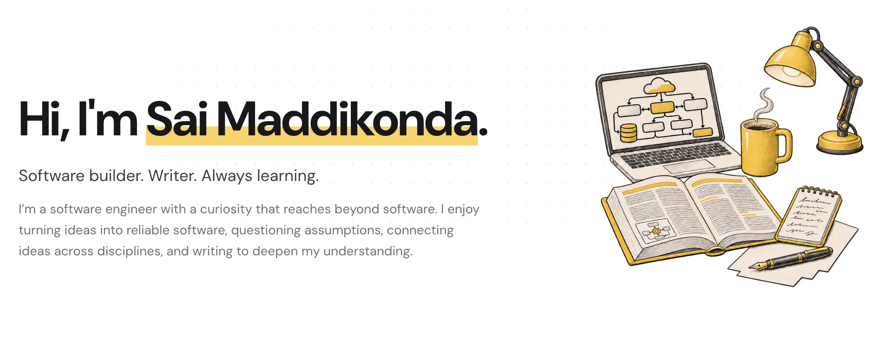

# Hi there!
I love building software — the craft, the problem-solving, and the satisfaction of seeing an idea become something people rely on. Over nearly a decade of professional work, I've built across the stack, with a focus on distributed systems, cloud applications, and, more recently, AI.

I care about understanding the problem, making thoughtful decisions, and seeing things through — from the first sketch to launch and beyond. I'm quietly confident in my craft, curious about what I don't yet know, and always finding ways to get better.

Beyond software, I write, follow world affairs, and explore ideas across disciplines. I enjoy connecting those ideas, questioning my assumptions, and letting what I learn shape what I build and how I live.

# Get in touch
[Website](https://www.smaddikonda.com) | [Builder's Notes](https://www.smaddikonda.com/builder-notes) | [Personal Blog](https://blog.smaddikonda.com) | [LinkedIn](https://www.linkedin.com/in/smaddikonda) | [Contact Form](https://www.smaddikonda.com/contact)
